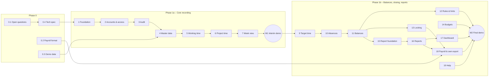

# 5. Implementation Plan

Step-by-step order for building the application. This plan only gives the **order, scope and completion criteria** of the work. Features, decisions and risks are described in docs 1–4 and are referenced here by ID (e.g. B-07, D-10, R-03) instead of being repeated.

> **Technology:** the only fixed choices are **Spring Boot** (backend) and **Angular** (frontend). The technical team decides everything else (architecture, storage, libraries, auth mechanism, build tooling) in its specification.

> **End point of this plan:** a **locally installed demo** with the complete MVP scope (Phases 1a and 1b), presented to stakeholders using demo data. Production hosting, real data, rollout and Phase 2 come after this plan (see 5.6).

---

## 5.1 Principles

1. **Build the foundations first.** Access control, audit logging, translations and accessibility are built at the start and every later feature uses them. Adding them afterwards would mean reworking finished features.
2. **Build features end to end.** Each step delivers working features in backend and frontend that can be demonstrated and tested. Backend and frontend are not built as separate layers.
3. **Follow the dependencies.** Recording needs master data, balances need recording, reports need balances, and locking needs audit. The step order reflects this.
4. **Show it early.** Phase 1a ends with an interim stakeholder demo. Phase 1b builds on that feedback.
5. **Apply the same definition of done to every step** (see 5.2).

## 5.2 Definition of Done (applies to every step)

A step is complete when, for every feature in it:

- [ ] it works end to end (backend + frontend) in the local installation,
- [ ] the demo data covers it, so it can be shown without manual preparation,
- [ ] automated tests cover the business rules (especially calculations and permissions),
- [ ] the **visibility rules (D-10)** are enforced on the server side and tested per role,
- [ ] every change to time data or admin data appears in the **audit trail** (H-01, H-02),
- [ ] all texts are available in **German and English** (D-12), including messages, emails and exports,
- [ ] it can be used in a phone-sized browser window and with the **keyboard only** (I-01, I-03),
- [ ] the backoffice representative has reviewed it in a demo.

---

## 5.3 Phase 0 – Preparation

### Step 0.1 – Clarify open business questions
**Goal:** no step is blocked by a missing business decision.

Decide and write down:
- Handling of employees exempt from working-time rules (D-01) and which rule checks apply (H-06) – with HR.
- Relationship between project time and working time: current assumption is "mismatch is only a hint" (B-14). Confirm it.
- Policies: session timeout duration, account lockout after failed logins, password rules.
- Definition of a "period" (calendar month?) and who may lock it.
- Budget warning thresholds (E-07) and who receives them (G-03).
- Source of public holidays per federal state and how holidays are maintained for each year (I-04).
- Absence types and how each one affects target time (B-15).

**Done when:** each item has a documented answer agreed by its owner (HR, backoffice, management).

### Step 0.2 – Agree the payroll export
**Goal:** the format of F-13 is fixed before reporting starts.
- Get a sample file or specification from payroll: fields, granularity, file format.

**Done when:** payroll has signed off on the format.

### Step 0.3 – Define the demo data and scenarios
**Goal:** realistic but fictitious data that shows every feature and every role.
- Fictitious users for all roles (incl. users with several roles), several teams and federal states, contract changes, opening balances.
- Projects with and without budgets, open and assigned projects, archived projects, the activity list, internal default projects.
- Test scenarios with expected results from HR (e.g. overtime balance after a month with holidays, absences and a contract change).

**Done when:** the data is available in the bulk import format (format defined in step 4) and HR has confirmed the expected results.

### Step 0.4 – Technical specification (technical team)
**Goal:** the technical team turns docs 1–5 into its specification (architecture, data model, interfaces, local setup, security concept).
- Must cover the hand-off notes in [04-roadmap.md §4.3](04-roadmap.md#43-hand-off-notes-for-the-technical-team): two kinds of time, time zones/DST/work past midnight, reproducible balances, locking and audit, soft deletion.

**Done when:** the specification has been reviewed and the team has estimated the steps below.

---

## 5.4 Phase 1a – Core recording

### Step 1 – Project foundation
**Goal:** an empty but runnable application that has all cross-cutting foundations in place.
- Spring Boot backend and Angular frontend set up, with automated build and tests.
- **Local installation** that can be started with a short, documented procedure on a standard developer or demo machine.
- Application shell: responsive layout, navigation per role, error and loading handling.
- Translation set-up with DE/EN switching (I-02), applied from the first screen.
- Accessibility baseline: keyboard navigation, focus handling, contrast, form labels (I-03).
- Outgoing email with DE/EN templates (invitations, resets, budget warnings). In the local installation, emails are captured locally and can be viewed instead of being delivered.

**Done when:** a "hello world" page starts from the documented local setup, can be switched between DE and EN, and a test email can be viewed.

### Step 2 – Accounts, login and access control
**Features:** A-01, A-02, A-03, A-04, A-05, A-07, A-08
**Goal:** users can log in securely. Every later feature checks the user's permissions in one consistent way.
- Login, logout, session timeout, account lockout (according to the policies from 0.1).
- Invitation flow and password reset through email.
- Roles (Employee, Project Lead, Backoffice Admin, Management). A user can hold several roles.
- **One central permission check** that implements the D-10 matrix and is reused by every later feature, report and export (H-05).
- Personal settings: language, default project, preferred view, notification preferences.
- Deactivated users cannot log in.
- Create the first admin account (bootstrap).

**Done when:** each role can log in, sees only its own navigation, and a deactivated user is locked out immediately.

### Step 3 – Audit foundation
**Features:** H-01, H-02 (mechanism)
**Goal:** a reusable change log exists before any business data is created.
- Record who changed what and when, including old and new values, for time entries and admin objects.
- Record when each entry was created (needed later for R-02).
- A simple admin screen to view the history of an object and the admin action log.

**Done when:** a change to a test object appears with user, timestamp, and old and new values.

### Step 4 – Master data administration
**Features:** U-01, U-02, U-03, U-05, U-06, U-08, E-01, E-02, E-04, E-06, E-09
**Goal:** backoffice can set up the company without technical help (G2, journeys J3, J4, J6).
- Users: create, edit, deactivate and reactivate, assign roles, team and federal state.
- Teams.
- Projects: create, edit, archive, project lead, members or "open to everyone".
- Global activity list.
- User–project assignment, from both the user side and the project side.
- Bulk import of users and projects from a spreadsheet, with validation and an error report.
- Internal default projects created and marked "open to everyone".
- Nothing is ever hard-deleted. Users are deactivated and projects are archived.

**Done when:** journeys J3, J4 and J6 work end to end and the demo data from 0.3 imports without errors.

### Step 5 – Working-time recording
**Features:** B-18, B-08, B-07 (working-day timer)
**Goal:** employees record the legal working day (D-01).
- Start, end and breaks for each day, entered manually or with "Start work / Pause / Stop".
- Correct handling of work past midnight, daylight saving time changes and multiple breaks (as specified in 0.4).
- Edit and delete until the period is locked. Locking itself comes in step 13, but the check should be prepared now (B-04, D-08).

**Done when:** an employee can record a full day by timer and by manual entry, and every change appears in the audit trail.

### Step 6 – Project time recording and day view
**Features:** B-01, B-03, B-04, B-05, B-07 (project timer), B-12
**Goal:** employees split their day across projects and activities.
- Project time entry: date, project, activity, start/end or duration, description.
- Only assigned projects and projects open to everyone can be selected. Archived projects cannot be selected.
- Project timer that creates entries automatically.
- Day view: working time, breaks and project entries with daily totals.

**Done when:** journey J1 works up to the point "sees daily total" (balances come in 1b).

### Step 7 – Week view and fast entry
**Features:** B-02, B-09, B-10, B-16
**Goal:** a typical day can be recorded in under a minute (success criterion "Speed").
- Week grid (projects × days) with direct entry.
- Copy the previous day or week.
- Favourite and recently used projects shown first.
- Recording optimised for a phone-sized browser.

**Done when:** a test user records a typical day in under 1 minute, on desktop and in a phone-sized browser.

### Step 8 – Interim stakeholder demo (Milestone M1)
**Goal:** show Phase 1a to stakeholders and collect feedback before Phase 1b.
- Run journeys J1, J3, J4 and J6 on the local installation with the demo data.
- Sort the feedback into "change in Phase 1b" and "later", and plan it.

**Done when:** the demo has taken place and the feedback is planned.

---

## 5.5 Phase 1b – Balances, closing and reports

### Step 9 – Working-time calendar and target time
**Features:** U-04, U-10, I-04
**Goal:** the system knows each user's target time for every day.
- Target hours and working days per user, with validity dates (contract changes take effect from a given date).
- Public holidays per federal state, maintained for each year.
- Opening overtime balance per user.

**Done when:** the target time for any past or future day can be calculated correctly for users whose contract changed or who moved between federal states.

### Step 10 – Absences
**Features:** B-15
**Goal:** vacation, sick days, holidays and other absences are recorded and counted towards target time (D-05).
- Employees mark absences themselves. Admins can mark them for others.
- Full and half days, if confirmed in 0.1.

**Done when:** absences affect target time exactly as agreed in 0.1.

### Step 11 – Balances and own summaries
**Features:** B-13
**Goal:** employees see target vs. actual time and their running overtime balance (D-07).
- Totals per day, week, month and project.
- Running overtime balance starting from the opening balance.
- **Balances for past periods can always be recalculated with the same result**, even after master data changes.

**Done when:** all HR test scenarios from 0.3 produce the expected balances.

### Step 12 – Rule checks and gap hints
**Features:** H-06, B-14
**Goal:** users see problems while they record (journey J2).
- Warnings for more than 10 h per day, missing breaks and rest periods shorter than 11 h (rule set from 0.1). These are warnings and do not block saving.
- Gap hints: day without entries, day below target, project time ≠ working time.

**Done when:** each rule and hint can be triggered by a test scenario and is shown in DE and EN.

### Step 13 – Period locking and admin corrections
**Features:** C-01, C-05
**Goal:** backoffice can close a period (D-03).
- Lock a period for all users or selected users, and unlock it if needed (agreed in 0.1).
- Employees cannot change data in a locked period. Admins can still correct entries, and every correction is fully logged.
- Locks are recorded in the admin action log.

**Done when:** after a lock, an employee's change attempt is rejected and an admin correction appears in the audit trail.

### Step 14 – Hour budgets and warnings
**Features:** E-07, G-03
**Goal:** project leads and backoffice notice before a budget runs out.
- Planned hours per project (total or per month), used hours vs. planned hours.
- Warning in the app and an email when a threshold is reached (sent only once per threshold).

**Done when:** crossing 80 % and 100 % produces exactly one warning each, sent to the right recipients.

### Step 15 – Reporting foundation and export
**Features:** F-04, F-05
**Goal:** one shared basis for all reports, so the reports in steps 16–17 only need configuration and layout.
- Filter and group by period, team, project, user and activity.
- Visibility rules (D-10) applied centrally to every query, report and export.
- Export to CSV and Excel for all reports. PDF for user and project reports, with DE/EN labels.

**Done when:** the same filter returns different data for each role, matching the D-10 matrix, and all three export formats work.

### Step 16 – Reports
**Features:** F-02, F-03, F-06, F-07, F-09, F-12
**Goal:** all detailed reports are available.
- Project report, user report (incl. monthly working-time record as PDF), completeness report, budget report, overtime report, project lead view.

**Done when:** each report is checked against hand-calculated demo data and can only be opened by the roles allowed to see it.

### Step 17 – Dashboard and management view
**Features:** F-01, F-14
**Goal:** an overview page for backoffice and an aggregated view for management.
- Total hours, hours per project and team, weekly trend, overtime totals, missing time, projects close to their budget.
- Management view contains **no per-person data**.

**Done when:** the management role cannot reach any per-person data, either through the UI or through exports.

### Step 18 – Payroll export and own-data export
**Features:** F-13, H-03
**Goal:** the month-end close can be completed and employees can get a copy of their own data.
- Payroll export exactly in the format agreed in 0.2.
- Employees view and download all of their own records.

**Done when:** payroll confirms that an export generated from demo data matches the agreed format, and journey J5 (check → export → lock) takes less than 1 hour.

### Step 19 – Help and user guide
**Features:** I-05
**Goal:** users can get started without training sessions.
- In-app hints on the main screens. A short user guide in DE and EN for employees, project leads and backoffice.

**Done when:** someone unfamiliar with the application records a full week using only the guide.

### Step 20 – Final stakeholder demo (Milestone M2)
**Goal:** the complete MVP scope runs locally and is presented to stakeholders. **This is the end of this plan.**
- **Acceptance check** of all MVP features from [02-feature-catalog.md](02-feature-catalog.md) against the demo data, including role and visibility tests.
- **Demo installation:** a fresh local installation, following the documented setup, loaded with the full demo data set.
- **Demo script** that walks through journeys J1–J6 with each role and switches between DE and EN.
- **Stakeholder demo** with backoffice, HR, payroll, project leads and management.
- Collect the feedback and decisions as input for the next stage.

**Done when:** the demo has taken place on a fresh local installation, all MVP features were shown, and the feedback is documented.

---

## 5.6 After this plan

The following topics are deliberately **not** part of this plan. They will be planned after the stakeholder demo, based on its feedback:

- Production hosting, operations, backups and monitoring.
- Security and accessibility review for productive use.
- Legal re-check (R-05) and review of the accepted risks R-01 – R-05, incl. works council and data protection officer (R-04).
- Import of real users, projects and opening balances.
- Pilot with real users, rollout, user communication and support during the first months.
- Phase 2 features (A-06, B-11, U-09, F-10, G-01).

---

## 5.7 Overview

**Possible parallel work** (with more than one developer or pair):
- Step 14 (budgets) can start as soon as step 6 is finished.
- Steps 9–10 (calendar, absences) can start alongside steps 6–7, because they only need master data.
- Step 19 (help) can be written alongside steps 15–18.
- Steps 0.2 and 0.3 (payroll format, demo data) run alongside development and must be finished before steps 18 and 4.
